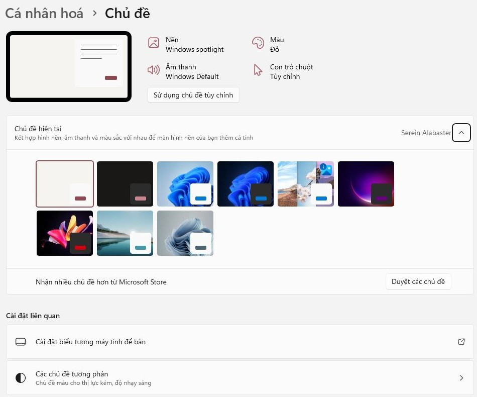
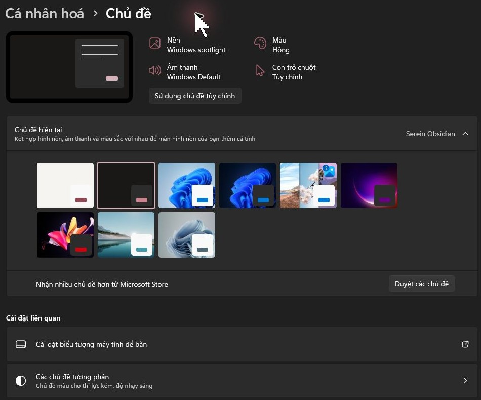

# Serein for Windows — Minimalist System Theme & Wallpapers

[](https://github.com/cmduyeen/serein-windows/releases/latest)
[](LICENSE)
[](https://github.com/cmduyeen/serein-theme)
[](https://cmduyeen.github.io/)

**Extreme minimalism. Everyday comfort.**

Serein for Windows brings peaceful, low-distraction desktop personalization to Windows 10 and 11. It pairs custom system accent colors with clean, warm 4K minimalist wallpapers in two calming palettes:

- **Serein Alabaster (Light):** Soft ivory desktop wallpaper with subtle complementary accent highlights.
- **Serein Obsidian (Dark):** Deep warm charcoal wallpaper with refined dark-mode desktop elegance.

[Download Latest Release](https://github.com/cmduyeen/serein-windows/releases/latest) · [Full Serein Suite](https://github.com/cmduyeen/serein-theme) · [Read Desktop Customization Guide](https://cmduyeen.github.io/)

---

## Preview

| Serein Alabaster · Light Mode | Serein Obsidian · Dark Mode |
|---|---|
| [](https://github.com/cmduyeen/serein-windows/releases/latest) | [](https://github.com/cmduyeen/serein-windows/releases/latest) |

---

## Key Highlights

- **4K Minimalist Wallpapers:** Custom generated high-resolution wallpapers perfectly tuned to the Serein canvas hex colors.
- **Harmonized Windows Personalization:** Coordinated taskbar, window border, and start menu accent tones.
- **Non-Destructive:** Uses native Windows `.theme` files with automated PowerShell install and restore scripts—no third-party DLL patching required.

---

## Installation

### Method 1: Automated PowerShell Script
1. Download and extract the latest `serein-windows-*.zip` from the [Releases page](https://github.com/cmduyeen/serein-windows/releases/latest).
2. Open PowerShell 7 in the extracted folder:
   ```powershell
   # Install and apply Alabaster (Light) theme:
   ./install.ps1 -Mode Light -Apply

   # Or install and apply Obsidian (Dark) theme:
   ./install.ps1 -Mode Dark -Apply
   ```
3. To restore your previous theme at any time, run:
   ```powershell
   ./restore.ps1
   ```

### Method 2: Manual Install
Double-click `alabaster.theme` or `obsidian.theme` directly to apply through standard Windows Settings.

---

## Complete the Serein Workspace

Complement your desktop wallpaper with unified developer tools:

- 🖥️ **[Serein for Windows Terminal](https://github.com/cmduyeen/serein-terminal)** — Warm console color schemes for PowerShell & WSL.
- 💻 **[Serein for VS Code](https://github.com/cmduyeen/serein-vscode)** — Clean code editor theme for developers.
- 📓 **[Serein for Obsidian](https://github.com/cmduyeen/serein-obsidian)** — Distraction-free markdown knowledge base.
- 💬 **[Serein for Telegram](https://github.com/cmduyeen/serein-telegram)** — Matching warm chat atmosphere.
- 🌐 **[All 10+ Serein Ports](https://github.com/cmduyeen/serein-theme)** — The central hub and design specifications.

---

## Honest Design & Limitations

Themes are aesthetic preferences and visual comfort tools, not medical treatments. Serein has not been clinically tested to treat eye strain. Ambient lighting, glare control, and regular breaks remain essential.
- [American Academy of Ophthalmology: Computer Usage Guidance](https://www.aao.org/eye-health/diseases/computer-usage)
- [Full design reference & limitations](https://github.com/cmduyeen/serein-theme/blob/main/REFERENCE.md)

---

## Author & License

Created and maintained by **[Dyn (cmduyeen)](https://cmduyeen.github.io/)**.
- Personal Blog: [cmduyeen.github.io](https://cmduyeen.github.io/)
- GitHub: [@cmduyeen](https://github.com/cmduyeen)

Released under the [MIT License](LICENSE).
